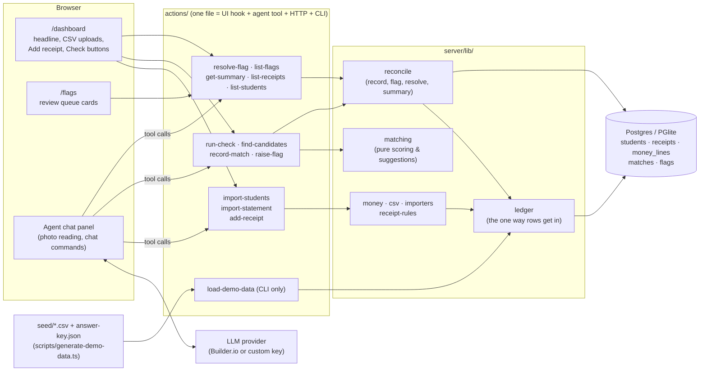

# FeeDesk — Project History

The living record of this project: what it is, how it's built, how it got here, and what's still rough.
Built from the git history (`git log --stat`, oldest first) and the code as it stands. Where a commit's
reason isn't recorded anywhere, this file says so rather than guessing.

---

## 1. Overview

**What it does.** FeeDesk checks a school's fee receipts against the money that actually arrived, so the
owner knows every receipt is backed by real money. Parents pay cash at the office or to the school's MoMo
merchant number, and the bursar writes a receipt. FeeDesk takes the receipts (typed, by chat, or read from a
photo of the receipt book), the MoMo merchant statement and the bank statement. It then matches each
receipt to the money that paid for it and puts only the mismatches in a review queue (the Flags screen).
All data is fictional: "Adenta Hills Academy".

Built for the Builder.io Agent-Native Hackathon (deadline Mon 9 Nov 2026, 11:59 PM PT). The plan is in
[`docs/HANDOFF.md`](HANDOFF.md).

**Stack**
- Design: "Banknote" direction, see [`docs/design/DIRECTION.md`](design/DIRECTION.md).
- [Agent-Native](https://www.agent-native.com/docs/) framework (`@agent-native/core` 0.223.0), started from
  its **Chat template**: React 19 + React Router 8 (UI), Vite 8, Nitro/h3 server, agent chat with actions.
- Postgres through Drizzle ORM: **PGlite** locally (`./data/pglite`), any Postgres URL when hosted.
- Zod schemas on every action, Tailwind CSS 4, Vitest.
- AI: the agent runs on whatever provider is connected in the app (Builder.io connection or custom keys).
  No AI calls in app code.

**Run it**
```bash
corepack enable && pnpm install
unset DATABASE_URL        # only if your shell sets a non-Postgres one (see Known issues)
pnpm demo:load            # reset the database to the fictional demo data
pnpm dev                  # http://localhost:8080 → Continue as local dev (or AUTH_DISABLED=true in .env)
```
Other commands: `pnpm demo:check` (run the matching without AI), `pnpm demo:generate` (rebuild `seed/`),
`pnpm test`, `pnpm typecheck`, `pnpm agent-native:doctor`.

---

## 2. Current architecture

**Not deployed yet.** Runs locally only. `netlify.toml` (from the template) is the intended route but hasn't
been configured or used; see Known issues.



**How the pieces connect**
- **Actions are the only door to the data.** The Dashboard and Flags screen call them with
  `useActionQuery` / `useActionMutation`; the agent calls the same actions as tools; the CLI runs them with
  `pnpm action <name>`. A click, a chat message and a confirmed photo row all reach `add-receipt` the same way.
- **`server/lib/ledger.ts` `addReceipts`** is the single way receipts enter the database. It applies the
  receipt rules (amount cap, date window, receipt-number normalising) for the form, chat, CSV and loader alike.
- **Matching is deterministic.** `matching.ts` scores MoMo receipts against MoMo lines (amount, date gap,
  parent's phone/name, reference) and cash receipts by day against bank deposits that add up exactly.
  `reconcile.ts` `recordMatches` auto-accepts only at confidence ≥ 0.9 **and** exact amounts; anything else
  is saved as a `proposed` match with a flag. `run-check` runs every page in one call.
- **The agent's job** is orchestration and judgement around the edges: reading receipt photos into rows for
  the bursar to confirm, running Check everything, explaining a receipt (`find-candidates` with
  `receiptNos`), and resolving flags from plain-language instructions ("those three were banked together
  Monday"). Its rules are the FeeDesk section at the top of `AGENTS.md`.
- **Context sharing:** `app/hooks/use-navigation-state.ts` publishes the current view (`dashboard`,
  `flags`) and the selected flag card (`flagId`), so "this one" in chat means the card on screen.
- **Schema & migrations:** `server/db/schema.ts` (Drizzle) and `server/plugins/db.ts` (named, additive
  migrations: `feedesk-core-tables`, `feedesk-proposed-matches`). Money is integer pesewas everywhere.

**Main files**

| Area | Files |
|---|---|
| Screens | `app/routes/dashboard.tsx`, `app/routes/flags.tsx`, `app/routes/school.tsx` (card wording from `app/lib/explain-flag.ts`), sidebar links in `app/components/layout/Sidebar.tsx` |
| Actions | `actions/*.ts` (FeeDesk: add-receipt, import-*, list-*, find-candidates, record-match, raise-flag, resolve-flag, get-summary, run-check, load-demo-data) |
| Logic | `server/lib/` (money, phone, csv, importers incl. the MTN layout, receipt-rules, ledger, matching, reconcile, school) |
| Data | `server/db/schema.ts`, `server/plugins/db.ts` |
| Agent | `AGENTS.md` (FeeDesk section first), `server/plugins/agent-chat.ts` (first-turn tools, system prompt) |
| Demo data | `scripts/generate-demo-data.ts` → `seed/`, loaded by `actions/load-demo-data.ts` |
| Tests | `server/lib/*.test.ts`, `app/lib/*.test.ts`, `tests/*.test.ts` (47 tests, incl. the full check against `seed/answer-key.json`) |

---

## 3. Timeline

Times are UTC (= Accra). Authors: "Claude" = Claude Code working for Kwame; "Builder.io" = Builder's coding
agent; merges on GitHub show as Isaac Agyapong.

### Phase 1 — Setup (Tue 3 Nov)

| Date | What changed | Why | Key files | Commit |
|---|---|---|---|---|
| 3 Nov 17:10 | Scaffolded the app from the Agent-Native Chat template; added the planning handoff and photo-test steps | Hackathon requires Agent-Native; Chat template chosen in the plan | whole template, `docs/HANDOFF.md`, `docs/PHOTO_TEST.md` | `ed27c6e` |
| 3 Nov 17:37 | Replaced the template README with a FeeDesk README (problem, flow, status, how to run, declared template and libraries) | The README described the template, not FeeDesk; hackathon rules require declaring the template | `README.md` | `9b60a3d` |

### Phase 2 — Photo test and attachments (Wed 4 Nov)

| Date | What changed | Why | Key files | Commit |
|---|---|---|---|---|
| 4 Nov 07:23–07:44 | Builder.io's agent turned on image/file attachments in the chat: an upload driver posting to the framework's file-upload endpoint, and a setup prompt when file storage isn't configured | The "+" menu had no Upload File option, so photos couldn't be attached (PR description) | `app/lib/agentkit-file-uploads.ts`, `app/components/home/HomePage.tsx`, `app/components/chat/ChatRouteContent.tsx` | `351d37f`, `eb0067c` |
| 4 Nov 07:50 | Recorded the photo test: **pass**, 29 of 30 fields read correctly from a sideways, two-page handwritten photo; the one miss came back as UNCLEAR | Prove the riskiest part (can the agent read photos?) before building on it | `docs/PHOTO_TEST.md` | `b2bcebb` |
| 4 Nov 22:00 | Merged Builder's attachment work ([Ikwame91/FeeDesk#1](https://github.com/Ikwame91/FeeDesk/pull/1)) after review and typecheck | Keep one code line; avoid two agents editing in parallel | — | `d630572` |

### Phase 3 — Demo data (Wed 4 Nov)

| Date | What changed | Why | Key files | Commit |
|---|---|---|---|---|
| 4 Nov 22:04 | Deterministic generator for fictional data: 45 students, 119 receipts (6 kept aside for the live photo), 103 MoMo lines, 7 bank deposits, planted mismatch cases, an answer key, and checks that the counts give the demo end state | The demo needs a believable, repeatable dataset with known answers (handoff §10) | `scripts/generate-demo-data.ts`, `seed/*` | `e5e4bb8` |
| 4 Nov 22:41 | Typo MoMo payments now carry the student's name as the reference; the generator checks each one links by name and parent phone | Review found receipt 1082's MoMo line had no reference, so it might not read as a typo | `scripts/generate-demo-data.ts`, `seed/momo-merchant-statement.csv` | `992a2f9` |

### Phase 4 — Data model and receipts (Wed 4 Nov)

| Date | What changed | Why | Key files | Commit |
|---|---|---|---|---|
| 4 Nov 22:41 | The 5 tables; import-students, import-statement, add-receipt, list-students, list-receipts; `pnpm demo:load`; Dashboard with CSV uploads, Add receipt form and latest receipts; GHS → pesewas tests (incl. 450.50) | Wednesday plan: tables, imports and the receipt form; review asked for exact pesewas conversion on every import | `server/db/*`, `server/plugins/db.ts`, `server/lib/{money,csv,importers,ledger}.ts`, `actions/*`, `app/routes/dashboard.tsx`, `tests/import-actions.test.ts` | `a6cda2a` |
| 4 Nov 22:56 | Receipt rules: GHS 100,000 cap with a friendly error (it used to crash the database), `01120` = `1120`, no future dates or dates over a year old, optional class with a mismatch warning, sign-in required on the list actions; tests | QA findings before starting matching | `server/lib/receipt-rules.ts`, `server/lib/ledger.ts`, `actions/add-receipt.ts`, tests | `83b0ee9` |

### Phase 5 — Matching and flags (Wed 4 Nov)

| Date | What changed | Why | Key files | Commit |
|---|---|---|---|---|
| 4 Nov 23:09 | find-candidates, record-match, raise-flag, resolve-flag, list-flags, get-summary; Flags screen with one-click resolutions; selected card shared with the agent; Dashboard headline and Check everything; FeeDesk rules moved to the top of AGENTS.md; a test running the full check against the answer key, reaching 118 of 120 verified · 2 flagged · 12 owing | Thursday/Friday plan: the core matching and the review screen | `server/lib/{matching,reconcile}.ts`, `actions/*`, `app/routes/flags.tsx`, `AGENTS.md`, `tests/matching-flow.test.ts` | `20dc6a4` |

### Phase 6 — Local setup fixes and credit saving (Sat 7 Nov)

| Date | What changed | Why | Key files | Commit |
|---|---|---|---|---|
| 7 Nov 07:21 | A check before `pnpm dev` / `pnpm demo:load` that names a non-Postgres `DATABASE_URL` and says where it's set | Kwame's shell had a Java `jdbc:postgresql://…` URL, which broke first-time setup with a vague error | `scripts/check-database-url.mjs`, `package.json` | `952a95f` |
| 7 Nov 09:48 | `run-check`: the whole check in one call with no AI; a **Check without AI** button and `pnpm demo:check`; the agent's Check everything now calls it once; fixed a doctor finding in the database check | Builder credits nearly used up; the agent loop took ~8 tool calls | `actions/run-check.ts`, `server/lib/reconcile.ts`, `app/routes/dashboard.tsx`, `AGENTS.md` | `dae612e` |
| 7 Nov 10:34 | Matching a payment now closes its open "money with no receipt" flag | Checking before entering the photo-page receipts left 6 stale cards on the Flags screen | `server/lib/reconcile.ts`, `tests/run-check.test.ts` | `8af19ac` |

### Phase 7 — Project record (Sat 7 Nov)

| Date | What changed | Why | Key files | Commit |
|---|---|---|---|---|
| 7 Nov | Added this file and the "Project history (required)" rule in `AGENTS.md`/`CLAUDE.md` | Owner asked for a living record kept up to date with every commit | `docs/PROJECT_HISTORY.md`, `AGENTS.md` | `41a5d3a` |

### Phase 8 — UI clarity (Sat 7 Nov)

| Date | What changed | Why | Key files | Commit |
|---|---|---|---|---|
| 7 Nov | Flag cards now say **What happened** and **What to do** in plain words (no confidence %, no `momo:` refs), with the raw evidence folded under "Evidence the check used"; cards are tinted by kind; the template's Home link is gone from the sidebar | Testing showed the cards were confusing; the Home page was a template leftover | `app/lib/explain-flag.ts` (+ test), `app/routes/flags.tsx`, `app/components/layout/Sidebar.tsx` | `4a20fa8` |
| 7 Nov | **Redesign: the "Banknote" direction.** Followed the App Designer method (brief → three rendered directions → one chosen → screens → shoot and critique, 3 rounds). New theme (bone paper, ink, one oxblood accent, designed dark mode), Bodoni Moda + Public Sans (Inter removed), guilloché seal and banknote underprint, FeeDesk wordmark. Overview and To review rebuilt as ruled pages instead of card stacks; the *settled* stamp when a flag is resolved. `get-summary` now returns `verifiedGhs` and `owedGhs` | Kwame asked for a calm, trustworthy, memorable design (Creativity & Design is 20% of judging); the old UI looked like the template | `docs/design/*`, `app/global.css`, `app/components/feedesk/Seal.tsx`, `app/routes/dashboard.tsx`, `app/routes/flags.tsx`, `app/components/layout/Sidebar.tsx`, `app/lib/explain-flag.ts`, `server/lib/reconcile.ts`, `actions/get-summary.ts`, `package.json` | `5a45da1` |


### Phase 9 — Real statement formats and school settings (Sat 7 Nov)

| Date | What changed | Why | Key files | Commit |
|---|---|---|---|---|
| 7 Nov | **Phones:** one shared rule turns every Ghana number into 0XXXXXXXXX (233…, +233…, 00233…, 9 digits, spaces/dashes) in every import and in matching; matching also finds the parent's name in a payment's REF. **MTN statements:** `import-statement` detects MTN's own export (TRANSACTION DATE … F_ID, REF, OVA), keeps only money paid *to* the school's number, uses F_ID as the transaction ID, reads dates like `06-Nov-2026 11:00:13 PM`, accepts amounts with any number of decimals (trailing zeros only), and for bank / cross-network payments takes the real sender's phone from REF. A fictional MTN-layout test file. **School settings:** `/school` page + `get-school-settings` / `update-school-settings` (name, term, MoMo number); the school line on every page now comes from settings, not code | Kwame supplied the real MTN export's headers; FeeDesk should work for any school, not just the demo one | `server/lib/phone.ts`, `server/lib/importers.ts`, `server/lib/money.ts`, `server/lib/matching.ts`, `server/lib/school.ts`, `actions/import-statement.ts`, `actions/*-school-settings.ts`, `app/routes/school.tsx`, `tests/mtn-statement.test.ts`, `tests/fixtures/mtn-momo-statement.csv` | (this commit) |

---

## 4. Decisions log

| # | Decision | Chosen | Why | Alternatives considered |
|---|---|---|---|---|
| 1 | Framework and starting point | Agent-Native, Chat template | Hackathon requirement; Chat is the minimal starter (handoff §5) | Other Agent-Native templates (Analytics, Forms) as patterns only |
| 2 | Product scope | Check receipts against money (FeeDesk) | Real workflow, no new habits for users; photo-to-match is the demo moment (handoff §3–4) | FeeMatch (dropped: schools already know who paid) and ~10 other ideas listed in handoff §3 |
| 3 | Money representation | Integer pesewas in the database; GHS strings with 2 decimals in actions | Exact sums, no float errors (handoff §6, `server/lib/money.ts`) | Floats or decimals in GHS |
| 4 | Database | PGlite locally, Postgres when hosted, via Drizzle; named additive migrations | Framework default; migrations named so branches can't collide (framework guidance) | Drizzle Kit generated migrations (the Chat template doesn't ship them) |
| 5 | Who sees what | One school's ledger: every signed-in staff member sees all rows; `owner_email` records who created a row | One school per deployment; per-user privacy would hide coworkers' work (`server/db/schema.ts` comment) | Framework sharing (`ownableColumns`, org visibility) |
| 6 | Where the matching logic lives | Deterministic code in actions; the agent orchestrates and handles the ambiguous cases | Framework rule: no AI inside actions; repeatable results that can be tested against the answer key | Letting the model score every pair (slow, costly, unrepeatable) |
| 7 | Auto-accept rule | Confidence ≥ 0.9 **and** exact amounts **and** the method fits (MoMo↔MoMo, cash↔bank), enforced in `record-match` | Handoff §9 sets 0.9; the extra checks stop a wrong agent guess from verifying a receipt | Trust the confidence number alone |
| 8 | Low-confidence matches | Saved as `proposed`, with a flag pointing at the match (`flags.match_id`) | Confirming the flag confirms the match in one step (migration `feedesk-proposed-matches`) | Throw the suggestion away and flag with no candidate |
| 9 | Result size for the agent | find-candidates pages ~40 receipts; receipts and money lines named by receipt number and `momo:<txn>` / `bank:<ref>` | Tool results over ~12,000 characters get cut off (commit `20dc6a4` says "paged to fit the agent's tool results"). Why readable ids were chosen over UUIDs isn't recorded | One big result; UUIDs |
| 10 | Credits | `run-check` does the whole check in one call; the agent calls it once | Builder credits nearly used up (commit `dae612e`) | Keep the agent paging through find-candidates (~8 calls) |
| 11 | One entry point for receipts | `addReceipts` applies all rules for form, chat, photo, CSV and loader | One code path (commit `83b0ee9`); demo point "same action from click, chat, photo" | Validate in each caller |
| 12 | Demo data | A deterministic generator with planted cases and an answer key, checked by tests | Repeatable demo; matching tuned against known answers (handoff §10) | Hand-written CSVs |
| 13 | Demo reset | `load-demo-data` action, CLI only (`http: false`, hidden from the agent), via `pnpm demo:load` | Reuses the real import code; can't be triggered from the web (`actions/load-demo-data.ts`) | A separate script with its own inserts |
| 14 | Agent instructions | FeeDesk section at the top of `AGENTS.md` | The runtime agent only reads the first 6,000 characters (build-an-app skill) | A separate runtime skill file |
| 15 | Photo attachments | Builder's hand-written upload driver to `/_agent-native/file-upload`; attachments on only when storage is configured | Needed for the photo flow (PR #1). Why a custom driver rather than a framework helper isn't recorded | — |
| 16 | Git workflow | One branch `scaffold-app`, plain commit messages without co-author lines | Owner's preference | Generated branch names, PR per feature |
| 17 | Visual direction | "Banknote": bone paper, ink, one oxblood accent, Bodoni Moda + Public Sans, guilloché seal, ruled pages, a *settled* stamp | Calm and trustworthy (security printing = "this money is real"), memorable for judges; chosen from three rendered directions (`docs/design/DIRECTION.md`) | B. Harmattan (warm colour field; read soft), C. Banking hall (dark, condensed, mono; read like a trading terminal) |
| 18 | Phone numbers | Store and compare every phone as 0XXXXXXXXX via one function (`server/lib/phone.ts`); unknown formats left as digits, never invented | Real statements write 233XXXXXXXXX while fee lists write 0XXXXXXXXX; a mismatch silently kills the strongest matching evidence | Normalise only at import (old rows and REF phones would still differ) |
| 19 | MTN statement direction | Keep a row only when TO NO. is the school's own MoMo number (from School settings); skip rows from the school's number | MTN's export mixes money in and out; the receiving number is the one unambiguous signal | Trust TRANS. TYPE values (vary, undocumented here); guess the school's number from the most common TO NO. (only suggested in the error, never assumed) |
| 20 | Real sender of pass-through payments | When FROM NO. isn't a mobile or FROM NAME looks like a bank/network/aggregator, take the phone from REF; matching also looks for the parent's name in REF | Kwame: bank and cross-network payments put the real sender in REF | Ignore REF (those payments would never match) |
| 21 | School details | One settings record (`feedesk-school` in the framework's settings table): name, term, MoMo number | One school per installation (decision 5); avoids school names in code | A schools table (only needed for many schools per installation) |
| 22 | PDF statements | Not parsed by FeeDesk; the agent turns a PDF into CSV text and calls `import-statement` | Kwame's call; PDF layouts vary and the agent can read them | A PDF parser in the app |

---

## 5. Known issues and tech debt

**Not built yet (from the plan)**
- No terms in the data: fees, balances and receipts are all for one term (the term on the School page is a label only).
- **Photo capture screen**: photo → editable rows beside the image → Confirm. Today photos only work in the
  chat, with the agent showing a table to confirm.
- **Students screen** (fee, paid, balance, status) and **reminder drafts** (`draft-reminders`).
- **Deployment.** Nothing is hosted. `netlify.toml` is still the template's: it has the template's Google
  Analytics/Tag Manager IDs (`GA_MEASUREMENT_ID`, `GTM_CONTAINER_ID`) and the template's
  `BETTER_AUTH_TRUSTED_ORIGINS`. Remove or replace these before deploying. A hosted DB (e.g. Neon),
  `BETTER_AUTH_SECRET` and file storage for photos are also still needed.

**UX found confusing in testing**
- The design critique was self-scored (`docs/design/CRITIQUE.md`), not done by an independent critic; contrast was checked by eye, not measured.
- App Designer itself (an iPhone design skill, third-party, no licence file) is not in the repo; only its method was applied.
- The Add receipt form defaults the date to today. Typing old receipts without changing it creates false
  "No money found" + "Money with no receipt" pairs.
- "Banked separately…" on a cash flag with no proposed deposit only opens the agent chat; there is no
  deposit picker.
- Template leftovers: the chat-first sidebar ("New chat", "My chats") and `/home` (Get started + Connect AI,
  no longer linked). The template logo is replaced by the FeeDesk wordmark.

**Shortcuts and risks**
- No per-user access control (decision 5). Fine for a one-school demo; not for real use.
- Status columns (`receipts.status`, `matches.state`) are plain text with CHECK constraints, not the
  framework's `defineMachine` state machines.
- `matches.receipt_ids` is a JSON text array, not a join table.
- Matching heuristics are tuned to the seed data: ±3-day MoMo window, 4-day deposit window, and a payment
  1 day late scores below 0.9 (so it gets flagged rather than verified).
- Two MoMo layouts are supported: MTN's own export (headers from a real export, values in the test file invented) and the simple merchant layout used by the demo data. Telecel and AirtelTigo exports, and real bank CSVs, are not supported yet; the agent can convert them (or a PDF) to CSV first.
- The "pass-through sender" rule (bank/network names, non-mobile FROM NO.) is a heuristic tested only on the invented MTN file.
- Seed dates are Sep–Oct 2026 and receipts older than a year are rejected, so `pnpm demo:load` will start
  failing in Sep 2027 (tests pin "today" and are unaffected).
- The real agent running **Check everything** has not been verified in an automated way; the tests and
  browser checks drive the same actions directly.
- `load-demo-data` reads `seed/` from disk, so it works from the CLI only. Loading a hosted database means
  running it locally with that `DATABASE_URL` and `AGENT_USER_EMAIL`.
- Builder.io credits are nearly used up; Custom keys are the fallback.
- A "script tag while rendering React component" console warning comes from the template, not FeeDesk code.

**Local setup gotchas (Kwame's laptop)**
- A shell `DATABASE_URL` from another project (`jdbc:postgresql://…`) breaks setup → `unset DATABASE_URL`
  (now detected by `scripts/check-database-url.mjs`).
- Remote/blocked local sign-in → `AUTH_DISABLED=true` in `.env` (local only, git-ignored).
- "Couldn't save Builder connection: fetch failed" → network to `mcp.builder.io`; try
  `NODE_OPTIONS=--dns-result-order=ipv4first pnpm dev`, or Custom keys.

---

## 6. Last updated

**7 Nov 2026**. Covers every commit up to **`5a45da1`** ("Redesign: the Banknote direction"), plus the
statement-formats and school-settings commit in Phase 9.
